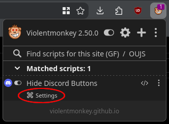

# Userscripts

A collection of userscripts. Userscripts are small JavaScript programs that run
in your browser to modify web pages to your liking.

## Installation

1. Install a userscript manager extension for your browser:
    - [Violentmonkey](https://violentmonkey.github.io/get-it/)
2. Navigate to the source of the userscript you want to install.
3. Copy the entire source code.
4. Open the userscript manager extension and create a new userscript.
5. Paste the source code into the userscript.
6. Save the userscript.

## Userscripts

> [!IMPORTANT]
>
> Some scripts require customization; you can open the settings for scripts that
> support it by clicking the "Settings" button under the script in your
> Userscript extension.
>
> 

<strong>Bluesky Hide Discover and Following Rows After</strong>

Hides the Discover feed and everything after it in the Following feed on
[Bluesky](https://bsky.app/).

[Source](./scripts/bluesky-hidediscover.js)

When browsing the Following feed, the Discover feed row is hidden, along with
all rows after it. This is done via a MutationObserver, so it keeps working as
new content is loaded.

<strong>Clyp Autoplayer</strong>

Automatically plays audio on [Clyp](https://clyp.it/), and ensures that only one
audio player is playing at a time.

[Source](./scripts/clyp-autoplayer.js)

This script is intended for follow-along stories that provide background music
via Clyp. It will automatically repeat the audio when it ends, and will close
previous tabs when a new audio player is started.

<strong>Discord Hide Buttons</strong>

Hides unwanted buttons in Discord's UI, such as the GIF picker, the Send Gift
button, the Server Boost button, and others. **Customizable Settings**

[Source](./scripts/discord-hidebuttons.js)

Can hide or show the following:

- Send a gift button in chatbox
- GIF picker button in chatbox (Can still send GIFs via emoji picker)
- Sticker picker button in chatbox (Can still send stickers via emoji picker)
- Emoji picker button in chatbox
- App Launcher button in chatbox

<strong>GitHub Custom Palette</strong>

Adds a quick-switch palette to [GitHub](https://github.com/), opened with
<kbd>Ctrl</kbd>+<kbd>K</kbd> (or <kbd>Cmd</kbd>+<kbd>K</kbd>), for jumping
directly to one of your own repositories.

[Source](./scripts/github-custompalette.js)

The palette lists all of your repositories (fetched from your repositories tab
and cached for 24 hours), supports type-ahead filtering, and can be navigated
with the arrow keys. The cache is automatically invalidated when a new
repository is created.

<strong>LP Archive Dark Mode</strong>

Adds a dark mode to the [LP Archive](https://lparchive.org/).

[Source](./scripts/lparchive-darkmode.js)

<strong>YouTube Music Auto Skip</strong>

Automatically skips songs on YouTube Music depending on user-defined rules.
**Customizable Settings**

[Source](./scripts/youtubemusic-autoskip.js)

Can automatically skip songs based on title or artist.

## License

Licensed under the [MIT License](./scripts/LICENSE).
